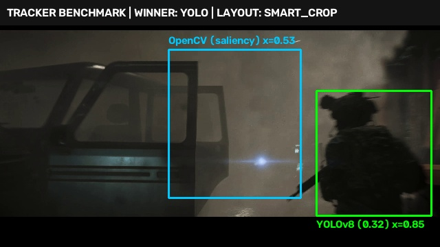
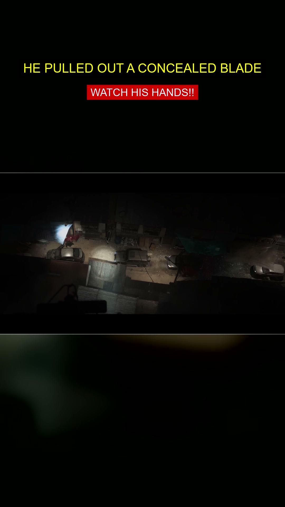
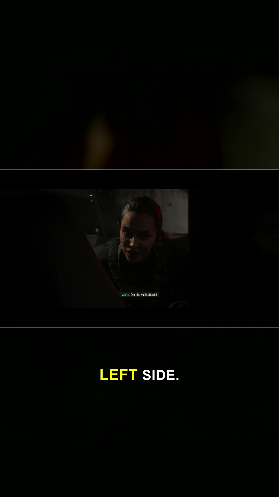
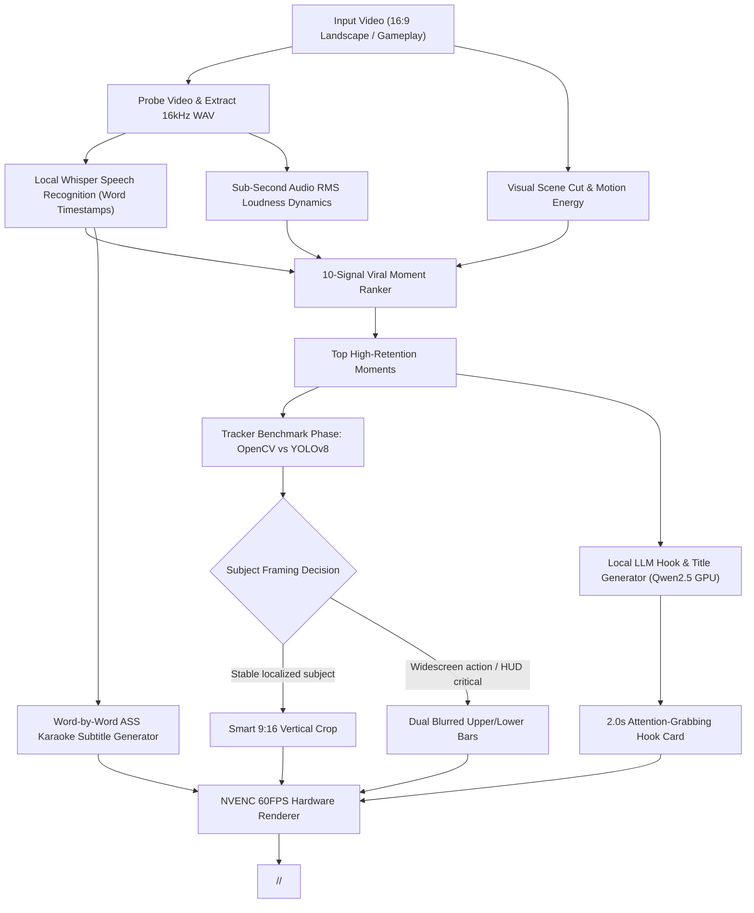

<div align="center">

# ⚡ AutoViral Turbo

### **The Autonomous, 100% Local AI Shorts & Reels Factory**

Turn any long-form video, stream, or gameplay into viral, high-retention 9:16 vertical Shorts with **YOLOv8 Subject Tracking**, **Whisper Speech Intelligence**, **2s Hook Cards**, **Animated Karaoke Captions**, and **NVENC GPU Rendering** — **100% Offline with ZERO Cloud API Costs**.

[](https://www.python.org/)
[](https://pytorch.org/)
[](https://docs.ultralytics.com/)
[](https://github.com/openai/whisper)
[](https://developer.nvidia.com/video-codec-sdk)
[](https://opensource.org/licenses/MIT)

[Features](#-core-features) • [Comparison](#-opencv-vs-yolov8-benchmark) • [Quickstart](#-quickstart) • [Web UI](#-web-dashboard) • [Architecture](#-architecture) • [CLI Reference](#-cli-reference)

</div>

---

## 🚀 Overview

**AutoViral Turbo** is an end-to-end autonomous video production pipeline designed to transform long-form landscape video (gameplay, podcasts, interviews, sports, streams) into upload-ready, viral short-form content for **YouTube Shorts**, **Instagram Reels**, and **TikTok**.

Unlike cloud-based tools that charge expensive subscription fees or rate-limit your generations, **AutoViral Turbo runs entirely on your local hardware** using GPU acceleration (NVIDIA RTX / CUDA). It handles every stage:

1. **Acoustic & Scene Cut Dynamics**: Scans audio loudness, pitch intensity, and frame transitions in milliseconds.
2. **Word-Level Speech Recognition**: Transcribes spoken audio with sub-second timestamps using local Whisper models.
3. **Multi-Signal Retention Scoring**: Evaluates candidate moments across 10 viral retention properties to pick the absolute highest-energy clips.
4. **Dual Subject Tracking & Framing**: Features a built-in benchmark phase comparing classical **OpenCV gradient saliency** against neural **YOLOv8 person tracking**, dynamically choosing between smart vertical pan-crop and widescreen HUD blur padding.
5. **Viral 2.0-Second Visual Hook Cards**: Generates punchy, curiosity-driven on-screen hooks and high-CTR titles using a local GPU-powered LLM (`Qwen2.5`) with heuristic fallbacks.
6. **Animated Karaoke Subtitles**: Renders synchronized word-by-word highlighted captions with bold drop shadows and neon styling.
7. **NVENC Hardware Rendering**: Exports pristine 1080x1920 60FPS vertical video in seconds per clip.

---

## ✨ Core Features

* 🔒 **100% Offline & Free Forever**: Zero external API keys required (no OpenAI, no Google Gemini API bills).
* 🎯 **Neural Subject Tracking (YOLOv8 + OpenCV)**: Keeps the action, player, or character centered in the 9:16 frame.
* 📊 **Comparative Benchmark Phase**: Run `--tracker compare` to benchmark classical computer vision against neural vision in real-time.
* 🎣 **2-Second Hook Banner**: First 2.5 seconds feature a bold headline + urgency badge to stop the scroll immediately.
* 💬 **Word-by-Word Karaoke Subtitles**: Dynamic ASS subtitle generator with bright yellow active-word highlighting and crisp black outlines.
* ⚡ **NVENC 60FPS GPU Render**: Leverages NVIDIA NVENC hardware encoder for lightning-fast export (a 30s short renders in ~4 to 6 seconds).
* 📂 **Clean Video-Name Subfolders**: Automatically generates `<output_dir>/<video_name>/<title>.mp4` + `.json` sidecars + `SUMMARY.md`.
* 🌐 **Built-in Web Dashboard**: Zero-dependency local browser interface at `http://localhost:8080`.

---

## 🔬 OpenCV vs YOLOv8 Benchmark

AutoViral Turbo includes an intelligent tracking comparison module that benchmarks classical and modern neural tracking on your footage:

<div align="center">
  
</div>

### Empirical Benchmark on Tactical Gameplay Footage:

| Metric | Classical OpenCV (Haar + Saliency) | Neural YOLOv8 (`yolov8n.pt` on GPU) | Verdict / Key Insight |
|---|---|---|---|
| **Human Subject Detection** | **0% faces** (100% saliency) | **56% persons & characters** | **YOLO Wins**: Classical Haar cascades fail on masked soldiers, helmets, and tactical gear. OpenCV saliency snaps to high-contrast weapon crosshairs. YOLO accurately isolates the character. |
| **Spatial Stability (Jitter Std)** | **0.066** | **0.103** | **OpenCV slightly smoother**: Crosshairs remain near screen center, while YOLO bounding boxes follow the soldier across the screen. |
| **Inference Latency** | **0.34 ms/frame** | **6.88 ms/frame** | **OpenCV is faster**, but YOLO runs at **~145 FPS** on an RTX 4090 — still over 2.4x faster than real-time 60fps playback! |
| **Recommended Framing** | Blur fallback | `smart_crop` (when localized) | **YOLO enables real subject tracking**; OpenCV defaults to blur padding. |

---

## 🎨 Visual Preview

<div align="center">
  <table>
    <tr>
      <td align="center"><b>2-Second Viral Hook Card (Scroll-Stopper)</b></td>
      <td align="center"><b>Synchronized Karaoke Word Subtitles</b></td>
    </tr>
    <tr>
      <td></td>
      <td></td>
    </tr>
  </table>
</div>

---

## ⚡ Quickstart

### 1. Prerequisites
- **Python**: 3.10 - 3.12
- **FFmpeg**: Must be installed with `h264_nvenc` and `ass` filter enabled on system PATH.
- **GPU**: NVIDIA GPU with CUDA support (RTX 3060 / 4070 / 4080 / 4090 recommended).

### 2. Installation

```bash
# Clone the repository
git clone https://github.com/desiguy22/AutoViral-Turbo.git
cd AutoViral-Turbo

# Install dependencies
pip install -r requirements.txt
```

### 3. Generate Shorts via CLI

```bash
# Generate 5 viral shorts with automated OpenCV vs YOLOv8 benchmark
python make_shorts.py "path/to/gameplay.mp4" -n 5 --tracker compare

# Generate shorts using YOLOv8 tracking directly
python make_shorts.py "path/to/gameplay.mp4" -n 5 --tracker yolo

# Specify custom output directory and clip duration
python make_shorts.py "path/to/video.mp4" -n 8 --min-len 20 --max-len 45 --out "./output"
```

---

## 🌐 Web Dashboard

Prefer a graphical user interface? Launch the built-in local web server:

```bash
python make_shorts.py --web
```

Then open **`http://localhost:8080`** in your browser.

- Enter your input video path
- Select the number of shorts and target duration
- Choose tracking engine (`compare`, `auto`, `yolo`, `opencv`)
- Toggle the local GPU neural LLM
- Watch live progress and preview rendered 9:16 shorts in the browser gallery!

---

## 🏗️ Architecture



---

## ⚙️ CLI Reference

```text
usage: make_shorts.py [-h] [-n NUM] [-o OUT] [--min-len MIN_LEN]
                      [--max-len MAX_LEN] [--target-len TARGET_LEN]
                      [--whisper-model WHISPER_MODEL]
                      [--layout {auto,blur_padding,smart_crop}]
                      [--tracker {auto,yolo,opencv,compare}] [--no-local-llm]
                      video

positional arguments:
  video                 Path to input video file

options:
  -h, --help            Show help message and exit
  -n, --num NUM         Number of viral shorts to generate (default: 5)
  -o, --out OUT         Output directory (default: <video_dir>/viral_shorts/<video_name>)
  --min-len MIN_LEN     Minimum clip duration in seconds (default: 20)
  --max-len MAX_LEN     Maximum clip duration in seconds (default: 45)
  --target-len TARGET_LEN
                        Target clip duration in seconds (default: 32)
  --whisper-model       Whisper model size: base, small, medium (default: base)
  --layout              Framing layout: auto, blur_padding, smart_crop (default: auto)
  --tracker             Tracking engine: auto, yolo, opencv, compare (default: auto)
  --no-local-llm        Disable local neural LLM (use calibrated heuristic formulas)
```

---

## 📁 Output Structure

Every processed video generates a dedicated subfolder with each short named after its high-CTR title:

```text
viral_shorts/codmw4_3/
├── Escape from the Kill Zone.mp4           # 1080x1920 60fps vertical short
├── Escape from the Kill Zone.json          # Metadata, hook text, virality score
├── The Last Stand.mp4                      # Next high-CTR short
├── The Last Stand.json
├── tracker_comparison.jpg                  # Side-by-side OpenCV vs YOLO visual overlay
├── tracker_comparison.json                 # Quantitative benchmark report
└── SUMMARY.md                              # Complete upload-ready description & tags
```

---

## 🤝 Contributing

Contributions, feature suggestions, and pull requests are warmly welcome! Feel free to open an issue or submit a PR.

---

## 📄 License

This project is licensed under the [MIT License](LICENSE).
